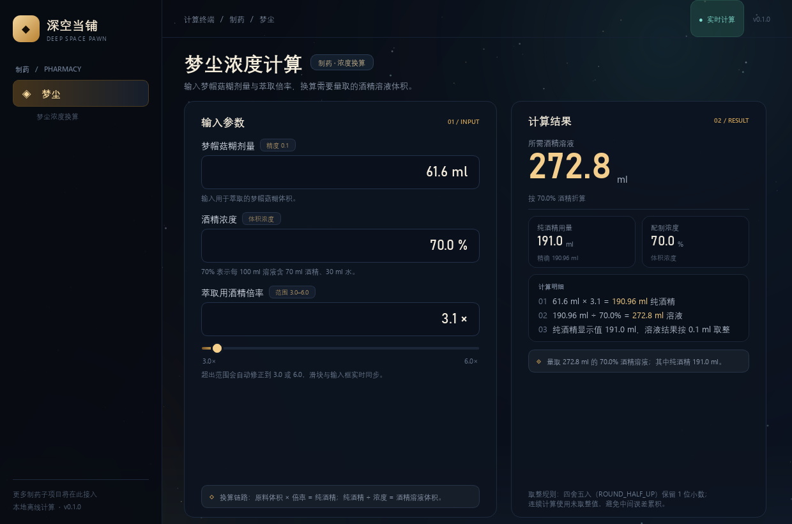

# 深空当铺计算器

《深空当铺》的离线便携计算终端。当前完成第一个功能：**制药 / 梦尘浓度计算**，后续按需求继续接入材料配比等模块。

## 提交说明

本仓库的提交说明统一写成“第 N 次提交；vX.Y.Z”。每次有更新，同步递增提交次数并更新版本号。

当前：`第一次提交；v0.1.1`。



## 当前功能

### 梦尘

输入三项条件，结果实时更新：

| 输入 | 精度 | 说明 |
| --- | --- | --- |
| 梦帽菇糊剂量 | 0.1 ml | 用于萃取的原料体积 |
| 酒精浓度 | 0.1 % | 体积浓度，70% 表示每 100 ml 溶液含 70 ml 酒精、30 ml 水 |
| 萃取用酒精倍率 | 0.1 倍 | 游戏范围 3.0–6.0，输入越界会自动夹到边界 |

倍率输入框与下方滑块双向绑定：改数字滑块跟着走，拖滑块数字同步变。

计算链路：

```text
纯酒精 = 梦帽菇糊剂量 × 萃取倍率
酒精溶液 = 纯酒精 ÷ 酒精浓度
```

结果区同时给出：

- 所需酒精溶液体积（ml）
- 纯酒精用量（ml）与未取整的精确值
- 配制浓度（%）
- 三步计算明细，以及实际量取提示

## 取整口径

所有展示数值按 **四舍五入（ROUND_HALF_UP）保留 1 位小数**，不使用 Python 默认的银行家舍入。

连续计算时使用未取整的中间值，避免误差累积。以 61.6 ml、3.1 倍、70% 为例：

```text
61.6 × 3.1 = 190.96 ml 纯酒精
190.96 ÷ 0.70 = 272.8 ml 溶液
```

纯酒精显示为 **191.0 ml**（190.96 四舍五入到 0.1 位），溶液显示为 **272.8 ml**。

> 注意：190.96 四舍五入到 0.1 位是 191.0，不是 190.1；若强行截成 190.1 再除以 0.7，会得到 271.6，和示例的 272.8 对不上。程序采用“精确中间值连续计算、最后统一取整”的口径，能复现 272.8。

如果后续确认游戏实际使用另一种取整规则，只需修改 `app/calculators/dream_dust.py` 中的计算与取整逻辑，UI 不用动。

## 运行源码

要求 Python 3.12+。

```powershell
python -m pip install -r requirements.txt
python main.py
```

窗口默认 1240×820，最小 1080×700，支持高 DPI 缩放。

## 打包 exe

```powershell
python -m pip install pyinstaller
python build.py
```

`build.py` 固定使用 `--onefile --windowed --uac-admin`，产物会请求管理员权限。

输出：

```text
dist\深空当铺计算器.exe
```

单文件 exe，首次启动会解压到系统临时目录，启动速度比源码模式略慢，属正常现象。

exe 的清单已写入 `requireAdministrator`，双击时 Windows 会先询问管理员权限；这是为了让单文件解压临时目录时有足够权限，避免普通权限下出现 `could not create temporary directory`。

### 关于 SmartScreen

当前 exe 没有代码签名，Windows SmartScreen 会显示“已阻止无法识别的应用”。这不是程序损坏，也不能靠改代码消除。处理方式：

1. 点“更多信息” → “仍要运行”（只影响本次）。
2. 想彻底消除提示，需要用微软信任的代码签名证书签名，并通过下载量积累声誉，或发布到 Microsoft Store；自签名证书与不签名一样会提示。

参见 [Microsoft SmartScreen 声誉说明](https://learn.microsoft.com/en-us/windows/apps/package-and-deploy/smartscreen-reputation)。

详细调整记录见 [调整日志.md](调整日志.md)。

## 项目结构

```text
main.py                         程序入口
build.py                        一键打包脚本（含 --uac-admin）
调整日志.md                      历次调整与打包记录
app/
  theme.py                      深空暗色主题与 QSS
  main_window.py                主窗口、侧栏、顶栏
  resources.py                  资源路径（兼容 PyInstaller）
  calculators/
    dream_dust.py               梦尘公式、四舍五入、参数校验
  pages/
    dream_dust.py               梦尘页面、输入控件、滑块联动
  widgets/
    starfield.py                星空背景
assets/
  app.ico / app.png             应用图标
tests/
  test_dream_dust.py            公式与取整测试
  test_ui.py                    页面交互测试
tools/
  make_icon.py                  重新生成图标
  capture_ui.py                 离屏截图，便于检查 UI
preview/main.png                界面预览图
```

## 测试

```powershell
python -m unittest discover -s tests -v
```

当前 18 项测试全部通过，覆盖示例结果、half-up 取整、越界夹取、滑块双向绑定和实时刷新。

## 后续扩展

新增计算项时：

1. 在 `app/calculators/` 下新建公式模块，保持纯计算、可单测；
2. 在 `app/pages/` 下新建页面，只负责输入与展示；
3. 在 `app/main_window.py` 的侧栏和 `QStackedWidget` 中注册入口。

这样公式与界面分离，后续加材料配比、其他药品或浓度换算时不会互相牵连。
